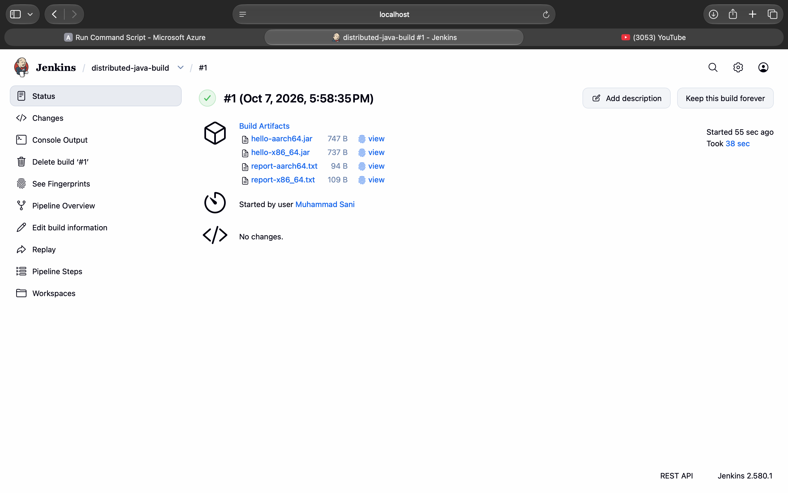

# Jenkins Remoting: Distributed Builds on ARM64 and AMD64

CodeAlpha DevOps Internship — Task 2  
Author: Muhammad Sani

## Objective

Configure Jenkins agents on different machines and CPU architectures, then distribute build work across those agents. This project uses a local ARM64 Docker agent on a MacBook Air and a native AMD64 agent on an Azure virtual machine.

## Verified result

On October 7, 2026, Jenkins job `distributed-java-build`, build **#1**, completed with **Finished: SUCCESS**. Its parallel branches compiled, packaged, and tested the same Java program on both agents. Jenkins archived two JAR files and two execution reports with fingerprints.

| Build agent | Location | Architecture reported | Runtime user |
| --- | --- | --- | --- |
| `agent-arm64` | Docker on MacBook Air M1 | `aarch64` | `jenkins` |
| `agent-cloud-amd64-v2` | Azure Ubuntu VM | `x86_64` | `jenkins` |

The earlier local `agent-amd64` was an emulated Docker agent on the M1 Mac. It was used for initial experiments, **not** as the AMD64 machine in the final distributed build. The final pipeline explicitly selects the Azure agent.

## Architecture

```text
MacBook Air M1
├── Docker: Jenkins controller (http://localhost:8080)
├── Docker: agent-arm64
└── SSH connection with loopback-only reverse forwarding
    └── Azure VM: jenkins-agent-cloud
        ├── Ubuntu 24.04 LTS / native x86_64
        ├── Dedicated jenkins user
        └── Inbound WebSocket agent
            → VM 127.0.0.1:18080
            → encrypted SSH tunnel
            → Mac 127.0.0.1:8080
```

The Jenkins controller schedules the parallel work; compilation and execution happen on the selected agents. Controller executors were set to zero. The cloud connection depends on the Mac, Docker controller, SSH tunnel, and cloud agent remaining running.

## Technologies and configuration

- Jenkins controller 2.580.1 and Jenkins Pipeline.
- Java 21 on the build agents.
- Docker Desktop on a MacBook Air M1 with 8 GB RAM.
- Azure `Standard_D2s_v4`: 2 vCPUs, 8 GiB RAM, Ubuntu Server 24.04 LTS, West US 3, availability zone 1.
- Standard SSD OS disk and SSH public-key authentication.
- Inbound Jenkins agent using WebSocket through an SSH reverse tunnel.
- Network security group permitting TCP 22 only from the current client public IPv4 address.
- Cloud node remote root: `/home/jenkins/agent`; one executor per build agent.

## Repository contents

```text
Jenkinsfile                    Tested distributed-build pipeline
src/Hello.java                 Java program used by the pipeline
docs/verification.md           Verified results and selected log excerpts
docs/evidence-checklist.md     Evidence to upload and submission checks
evidence/README.md             Instructions for adding original evidence
.gitignore                    Excludes keys, secrets, and generated build files
```

## Pipeline workflow

1. A five-minute timeout wraps the complete run, including agent allocation.
2. Two parallel branches allocate `agent-arm64` and `agent-cloud-amd64-v2` explicitly.
3. Each branch checks the actual CPU architecture and confirms it runs as `jenkins`.
4. Each branch writes the same Java source into its own agent workspace.
5. `javac` compiles the source; `jar` creates an executable JAR.
6. Each JAR runs a simple calculation check and prints `Java test passed!`.
7. Each branch records the node, hostname, architecture, user, and UTC timestamp.
8. Jenkins archives and fingerprints the JAR and report from each branch.

The Java source is embedded in the Jenkinsfile so this demonstration does not require an SCM checkout. `src/Hello.java` is included for readability. The architecture-specific filenames identify **where the JAR was built**; these contain Java bytecode, not architecture-specific native executables. This is a small functional demonstration, not a performance benchmark or a production application test suite.

## Run the demonstration

### Prerequisites

Both Jenkins agents must be registered and online, Java 21 must provide `java`, `javac`, and `jar`, and the cloud agent directory must be writable by its dedicated `jenkins` user. Keep secrets outside the repository.

### Establish the cloud tunnel

Run the following in a **Mac Terminal tab**, replacing `VM_PUBLIC_IP` with the VM's current public IP. Keep this tab open.

```bash
ssh -4 -N \
  -o IdentitiesOnly=yes \
  -o ExitOnForwardFailure=yes \
  -o ServerAliveInterval=30 \
  -o ServerAliveCountMax=3 \
  -i ~/Downloads/jenkins-agent-cloud_key.pem \
  -R 127.0.0.1:18080:127.0.0.1:8080 \
  azureuser@VM_PUBLIC_IP
```

In a separate VM session, verify the forwarded Jenkins endpoint:

```bash
curl -sS -I --max-time 15 http://127.0.0.1:18080/login
```

The successful setup returned HTTP 200. Do not open public inbound ports 8080 or 50000 for this arrangement.

### Start the cloud agent if it is not already running

From a VM shell logged in as `azureuser`, switch to the dedicated account:

```bash
sudo -iu jenkins
```

As `jenkins`, check for an existing agent before launching another:

```bash
pgrep -u jenkins -f 'agent.jar'
```

If one is running, check its status instead of starting a duplicate. If none is running, use the existing agent JAR and private secret file:

```bash
cd /home/jenkins/agent
java -Xmx256m -jar agent.jar \
  -url http://127.0.0.1:18080/ \
  -secret @secret-file \
  -name agent-cloud-amd64-v2 \
  -webSocket \
  -workDir /home/jenkins/agent
```

`secret-file` must contain the correct secret for this node and be readable only by its owner. Never paste its contents into logs, documentation, screenshots, or GitHub. It is intentionally not provided in this repository. Leave the agent running while building.

### Execute in Jenkins

1. Open the local Jenkins dashboard.
2. Create a Pipeline job named `distributed-java-build`.
3. Select **Pipeline script**, paste the contents of `Jenkinsfile`, and save.
4. Select **Build Now**, then inspect **Console Output**.
5. Confirm the two node names, both `Java test passed!` messages, and `Finished: SUCCESS`.
6. Download the four archived artifacts from the build page.

The demonstrated job used a manually pasted Pipeline script. Publishing this repository does not automatically connect it to Jenkins or configure a webhook.

## Troubleshooting performed

| Symptom | Finding and resolution |
| --- | --- |
| SSH timed out on the original Wi-Fi connection | The VM was running, SSH was listening, and Azure IP flow verification allowed the specified traffic. Switching to a phone hotspot and updating the NSG source IP made SSH reachable. The exact cause on the original connection was not established. |
| Azure Run Command reported an empty secret and `[[ : not found` | Separate non-interactive executions did not retain the interactive shell variable, and that shell did not support Bash's `[[` syntax. The secret was captured in the interactive VM shell and stored privately. |
| Agent directory access denied as `azureuser` | The directory belonged to the dedicated `jenkins` account. Starting the agent as `jenkins` resolved access without making the directory world-writable. |
| Cloud disk monitor showed `N/A` | The node remote root was corrected to `/home/jenkins/agent`. Later monitoring reported 25.32 GiB free disk space. |
| Agent could not reach `127.0.0.1:18080` | The SSH reverse tunnel was not listening. Re-establishing it allowed the agent to connect. |
| Repeated connects and disconnects | One agent remained running after a second foreground process was stopped. We avoided launching another process; subsequent cloud and distributed jobs succeeded. Competing processes were suspected, not conclusively proven as the cause. |

## Security and operational limits

- SSH access is restricted to the client's current public IP; update the NSG after changing networks.
- The forwarded port is bound to VM loopback, and Jenkins on the Mac is bound to local loopback. HTTP on these local endpoints is transported between machines through encrypted SSH.
- Build processes run as `jenkins`, not root. Private SSH keys and node secrets are excluded.
- A previously exposed cloud node secret was replaced by creating a new node name. Never reuse an exposed credential.
- This is a supervised lab connection, not an unattended production deployment. Persistent service supervision and a production connectivity design were not implemented.
- Jenkins reported no swap on the cloud VM. The demonstrated builds still succeeded; swap was not added merely to clear a monitor warning.
- Azure auto-shutdown was configured for 01:30 Pakistan Standard Time. Save work before shutdown.
- At the displayed rate during setup, VM compute was $0.096/hour; this is historical configuration information, not a current quote. Disk and public IP costs are separate. Confirm **Stopped (deallocated)** after stopping the VM to avoid continued compute billing.

## Evidence and submission status

The build result and artifact list were verified from the user's Jenkins screenshots and console output. Selected excerpts are preserved in `docs/verification.md`. The downloaded execution reports and three original screenshots are included in `evidence/`. The complete console log and optional node-status screenshot can still be added; see the checklist. This documentation does not claim a walkthrough video or final internship submission has already been completed.

### Successful distributed build



### Agent execution reports

- [ARM64 text report](evidence/report-aarch64.txt) and [original screenshot](evidence/arm64-report.png).
- [Azure AMD64 text report](evidence/report-x86_64.txt) and [original screenshot](evidence/amd64-report.png).

Suggested public repository name: **CodeAlpha_Jenkins_Remoting**.
